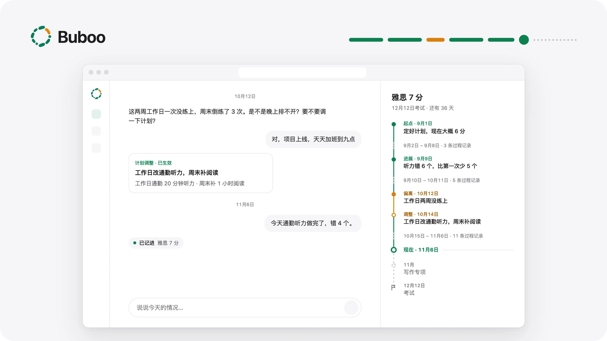
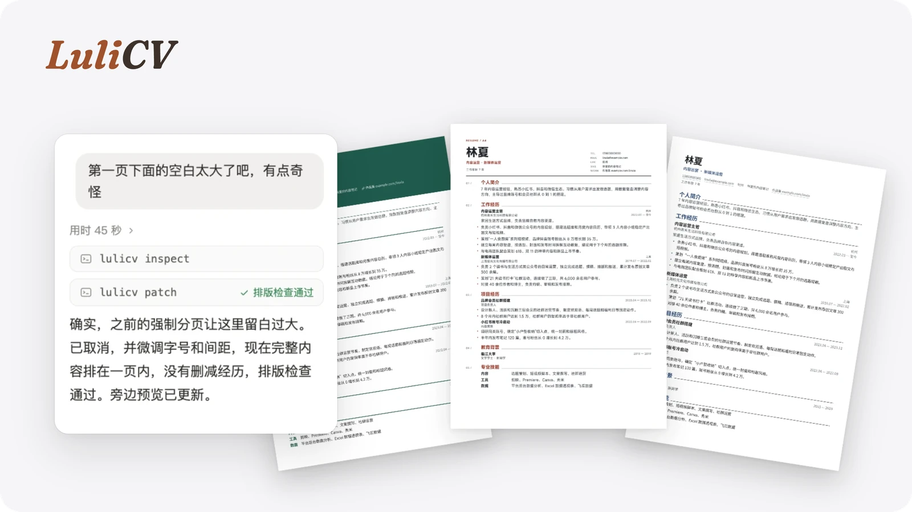

<b>English</b> &nbsp;·&nbsp; <a href="README.zh-CN.md">简体中文</a>

<h1>Hey, I'm Ari. 👋</h1>

<h3>Building thoughtful AI products &amp; agents.</h3>

I explore how AI agents can become useful, reliable products — from product ideas and interaction design to agent architecture, engineering, and evaluation.

AI AGENTS &nbsp;·&nbsp; PRODUCT THINKING &nbsp;·&nbsp; CONTEXT &amp; MEMORY &nbsp;·&nbsp; HUMAN-AI COLLABORATION &nbsp;·&nbsp; EVALUATION

 

## Selected Projects

Two shipped projects: a personal agent in live beta, and an open-source tool that plugs into the agents people already use.

<table>
  <tr>
    <td width="50%" valign="top">
      
      <h3>Buboo</h3>
      
<b>Long-term Personal Agent</b> <code>Live&nbsp;Beta</code> <code>Closed&nbsp;Source</code>

      
An AI agent for long-term goals, evolving plans, and proactive assistance.

      <ul>
        <li>Turns a goal into a staged plan and keeps track of progress from everyday check-ins.</li>
        <li>Notices when things drift and proposes a revised plan — changes apply only after you confirm.</li>
        <li>Runs periodic reviews and watches for outside updates that matter to the goal.</li>
      </ul>
      
Agent Runtime · Long-term Memory · Context Engineering · Human-in-the-loop · Proactive Agent

    </td>
    <td width="50%" valign="top">
      
      <h3>LuliCV · 履栗</h3>
      
<b>Agent-native Resume Workspace</b> <code>Open&nbsp;Source</code> <code>MIT</code>

      
A local-first resume workspace that lets users and AI agents edit, review, and export together.

      <ul>
        <li>Extends existing agents through a Skill and CLI instead of shipping its own chatbot.</li>
        <li>One shared workspace: every human or agent edit is versioned and can be undone.</li>
        <li>Real A4 pagination — preview, layout checks, and PDF export share one renderer.</li>
      </ul>
      
Agent Skills · CLI · Local-first · Human-AI Collaboration · Structured Editing

      
<a href="https://github.com/AriLabo/LuliCV">View repository →</a>

    </td>
  </tr>
</table>

 

## What I'm Interested In

<table>
  <tr>
    <td width="56" align="center" valign="top"></td>
    <td valign="top">
      <b>Agent Systems</b> 
      Workflows, tools, state management, and reliable execution. 
      An agent earns trust by staying predictable over many steps, not by one impressive answer.
    </td>
  </tr>
  <tr>
    <td width="56" align="center" valign="top"></td>
    <td valign="top">
      <b>Context &amp; Memory</b> 
      Long-term context, retrieval, and continuity. 
      What to keep, what to let go, and when to bring something back into the conversation.
    </td>
  </tr>
  <tr>
    <td width="56" align="center" valign="top"></td>
    <td valign="top">
      <b>Product &amp; Evaluation</b> 
      Human-AI interaction, quality, and real-world outcomes. 
      Judged by whether people actually get further, and where they should stay in control.
    </td>
  </tr>
</table>

 

---

AriLabo · Ideas, experiments &amp; open-source projects.
