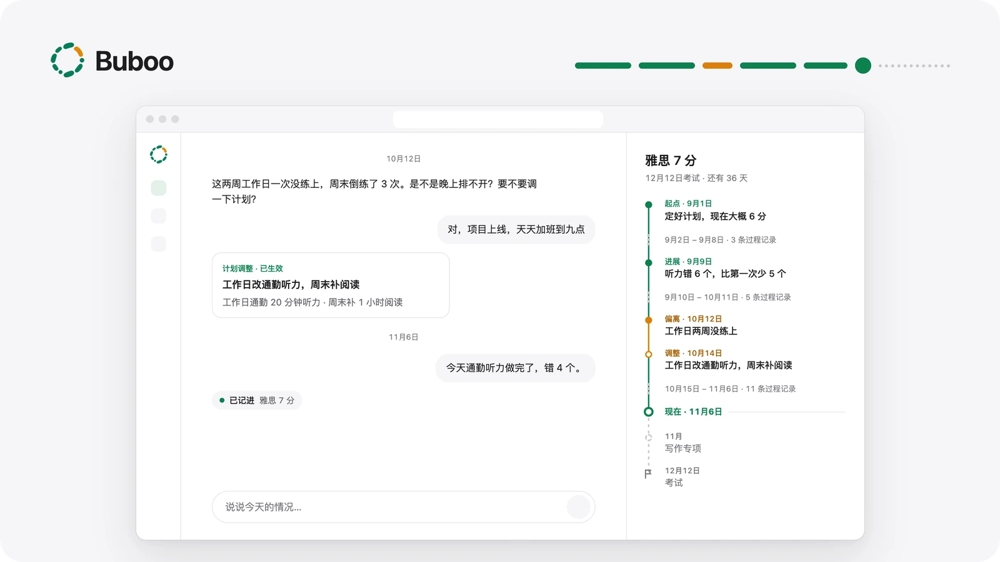
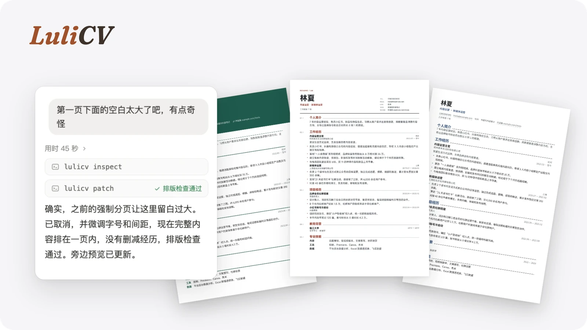

<a href="https://github.com/AriLabo">English</a> &nbsp;·&nbsp; <b>简体中文</b>

<h1>嗨，我是 Ari。👋</h1>

<h3>用心做 AI 产品与 Agent。</h3>

我关注 AI Agent 怎样成为真正有用、可靠的产品——从产品构想、交互设计，到 Agent 架构、工程实现和效果评估。
AI AGENT &nbsp;·&nbsp; 产品思考 &nbsp;·&nbsp; 上下文与记忆 &nbsp;·&nbsp; 人机协作 &nbsp;·&nbsp; 效果评估

 

## 精选项目

两个已经上线的项目：一个正在内测的长期个人 Agent，一个接入你已有 Agent 的开源工具。

<table>
  <tr>
    <td width="50%" valign="top">
      
      <h3>Buboo</h3>
      
<b>长期个人 Agent</b> <code>内测中</code> <code>闭源</code>

      
陪你推进长期目标的 AI Agent：计划会随实际情况调整，也会主动提供帮助。

      <ul>
        <li>把目标拆成分阶段的计划，从日常打卡里持续记录进度。</li>
        <li>发现进度偏离时主动提出新计划，你确认后才会生效。</li>
        <li>定期复盘，并留意和目标有关的外部变化。</li>
      </ul>
      
Agent Runtime · 长期记忆 · 上下文工程 · Human-in-the-loop · 主动式 Agent

    </td>
    <td width="50%" valign="top">
      
      <h3>LuliCV · 履栗</h3>
      
<b>Agent 原生的简历工作区</b> <code>开源</code> <code>MIT</code>

      
本地优先的简历工作区，你和 AI Agent 一起编辑、检查、导出。

      <ul>
        <li>通过 Skill 和 CLI 扩展你已经在用的 Agent，而不是再做一个聊天机器人。</li>
        <li>人和 Agent 共用一个工作区：每次修改都有版本记录，随时可以撤销。</li>
        <li>真实的 A4 分页：预览、排版检查和 PDF 导出用的是同一个渲染器。</li>
      </ul>
      
Agent Skills · CLI · 本地优先 · 人机协作 · 结构化编辑

      
<a href="https://github.com/AriLabo/LuliCV">查看仓库 →</a>

    </td>
  </tr>
</table>

 

## 我关注的方向

<table>
  <tr>
    <td width="56" align="center" valign="top"></td>
    <td valign="top">
      <b>Agent 系统</b> 
      工作流、工具调用、状态管理与可靠执行。 
      Agent 赢得信任，靠的是在很多步里都表现稳定，而不是一次惊艳的回答。
    </td>
  </tr>
  <tr>
    <td width="56" align="center" valign="top"></td>
    <td valign="top">
      <b>上下文与记忆</b> 
      长期上下文、检索与连续性。 
      该记住什么、该放下什么，什么时候把旧信息重新带回对话。
    </td>
  </tr>
  <tr>
    <td width="56" align="center" valign="top"></td>
    <td valign="top">
      <b>产品与评估</b> 
      人机交互、质量与真实效果。 
      看用户是不是真的往前走了，以及哪些环节应该由人来把控。
    </td>
  </tr>
</table>

 

---

AriLabo · 想法、实验与开源项目。
